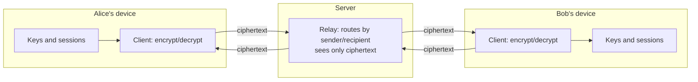

# SecureChat (Node.js): An End-to-End Encrypted Chat Application with a Double Ratchet Protocol

## Abstract

Ordinary chat systems protect messages only between each user and the server, so the
operator, or anyone who compromises the server, can read everything. This project
implements SecureChat, a chat application with true end-to-end encryption: messages are
encrypted on the sender's device and decrypted only on the recipient's, and the relay
server handles nothing but ciphertext. SecureChat implements an X3DH-style key-agreement
handshake and a Signal-style Double Ratchet, giving a unique key for every message,
forward secrecy, and recovery after a state compromise. A packet-capture demonstration
shows that a known plaintext never appears in the bytes transmitted over the network,
while the recipient recovers it exactly. The system is built in Node.js using only the
platform's built-in `crypto` and `net` modules, so it has no external dependencies, and
it is covered by eleven automated tests including a live two-client conversation over TCP.

## 1. Introduction

Messaging security is usually described as encryption "in transit". Transport encryption
such as TLS protects the link between a user and a server, but the server itself sees
plaintext. End-to-end encryption (E2EE) removes the server from the trust boundary: only
the two communicating users can read the messages. This project builds a working E2EE
chat system in Node.js and, importantly, demonstrates the property rather than merely
asserting it.

## 2. Objectives

1. Implement a key-agreement handshake so two parties derive a shared secret without ever
   transmitting it.
2. Encrypt every message with authenticated encryption so messages cannot be read or
   altered in transit.
3. Provide forward secrecy and post-compromise security through a Double Ratchet.
4. Build a relay server that can route messages while being unable to read them.
5. Demonstrate, with a network capture, that plaintext never crosses the wire.

## 3. Background

**Diffie-Hellman key exchange** lets two parties agree on a shared secret over a public
channel: each combines their own private key with the other's public key and arrives at
the same value, which an eavesdropper cannot compute from the public keys alone.
SecureChat uses X25519, a modern elliptic-curve variant with 32-byte keys, via Node's
`crypto.diffieHellman`.

**Authenticated encryption (AEAD)** provides both confidentiality and integrity.
SecureChat uses AES-256-GCM, which attaches an authentication tag so any tampering with
the ciphertext, or with associated data such as the message header, is detected on
decryption.

**X3DH (Extended Triple Diffie-Hellman)** is the handshake used by the Signal protocol.
It combines several Diffie-Hellman operations between long-term identity keys, medium-term
signed prekeys and single-use one-time prekeys, so the resulting secret depends on both
parties' identities (authentication) and on fresh ephemeral material (secrecy), and a
sender can begin a session even if the recipient is offline.

**The Double Ratchet** combines two mechanisms. A symmetric-key ratchet advances a chain
of keys with a one-way function for every message, so each message has its own key and no
key can be worked backwards to recover an earlier one. A Diffie-Hellman ratchet mixes a
fresh key exchange into the chain each time the direction of conversation turns. Together
these give forward secrecy (a stolen key cannot decrypt past messages) and
post-compromise security (after a compromise, new key material the attacker never saw
restores secrecy for future messages).

## 4. Why Node.js

Node.js was chosen for three reasons. Its built-in `crypto` module provides vetted,
standards-compliant implementations of X25519, HKDF-SHA256 and AES-256-GCM, so no
third-party package is required and the primitives are not hand-written. Its `net` module
and event-driven model make an asynchronous relay server and clients straightforward. And
because JavaScript also runs in the browser, the same protocol logic can later be reused
in a web client, which is a natural extension of the project.

As in any language, the project does not implement cryptographic primitives itself; it
composes the platform's audited primitives into the handshake, ratchet and protocol. This
is the correct practice: hand-written cryptography is error-prone and strongly discouraged.

## 5. System design



All cryptography happens in the clients. The server stores each user's public prekey
bundle, so others can begin sessions, and forwards messages by looking only at the `to`
and `from` fields; the `header` and `body` are opaque to it.

## 6. Implementation

The system is layered so each part can be read and tested on its own.

| Module | Responsibility |
|---|---|
| `crypto.js` | X25519 Diffie-Hellman, HKDF key derivation, AES-256-GCM AEAD; the root and chain key-derivation functions used by the ratchet |
| `ratchet.js` | the identity and prekey bundle, the X3DH initiator/responder handshake, and the Double Ratchet with its symmetric and DH ratchets and out-of-order handling |
| `protocol.js` | length-prefixed JSON framing, with a parser that reassembles frames split across TCP reads |
| `server.js` | the zero-knowledge relay |
| `client.js` | the client; performs all encryption and decryption locally, with a single socket handler that dispatches frames |
| `chatapp.js` | the interactive terminal interface |

**Representing keys on the wire.** X25519 public keys are 32 raw bytes, but Node's key
objects use the DER/SPKI encoding. The crypto module converts between them by stripping or
prepending the fixed 12-byte SPKI header, so only the 32 raw bytes travel over the network.

**Key derivation.** A root key-derivation function mixes each new Diffie-Hellman result
into the root key and produces a new chain key. A chain key-derivation function advances a
chain one step, yielding the next chain key and a single message key. Because these are
built on HKDF-SHA256, they are one-way: knowing a later chain key reveals nothing about
earlier message keys, which is the mechanism behind forward secrecy.

**Message binding.** Each message's header, the sender's current ratchet public key and
the message counters, is passed as associated data to AES-GCM, so a header cannot be
swapped or altered without the authentication check failing.

**Out-of-order delivery.** Networks reorder and drop packets. When a message arrives with
a counter ahead of what is expected, the receiver derives and stores the intervening
message keys so late-arriving earlier messages can still be decrypted, up to a bound that
prevents abuse.

**Framing.** TCP is a byte stream with no message boundaries, so each frame is prefixed
with its length. The `FrameParser` buffers incoming bytes and emits whole frames only once
fully received; a test feeds a frame split across two chunks to confirm this.

**Concurrency.** The client uses a single `data` handler per socket that dispatches each
frame to the right place; request and reply operations such as fetching a prekey bundle
wait on a promise the handler resolves. This avoids two parts of the code competing to
read the same stream, a class of bug that affected an early version of the sibling Python
implementation.

## 7. Evaluation

### 7.1 Functional tests

Eleven automated checks (`node tests/run.js`) cover the layers and the security claims:

| Test | What it establishes |
|---|---|
| DH agreement | both parties compute the same shared secret |
| chain KDF is one-way | each step yields distinct keys that cannot be reversed |
| AEAD detects tampering | a single flipped bit in the ciphertext is rejected |
| X3DH secret matches | initiator and responder derive the same secret |
| eavesdropper cannot derive secret | public keys alone do not yield the secret |
| every message uses a different key | repeated identical plaintext gives different ciphertext |
| forward secrecy | a used message key is not recoverable from later state |
| out-of-order delivery | messages decrypt correctly when reordered |
| tampered ciphertext rejected | integrity holds at the ratchet layer |
| break-in recovery | the root key advances as the conversation turns |
| live end-to-end conversation | two clients exchange messages through the real server over TCP |

All eleven pass.

### 7.2 Network-capture demonstration

`scripts/capture_demo.js` starts the relay, connects two clients, and taps the raw bytes
written to the sockets. Alice sends the plaintext "ATTACK AT DAWN meet me at the old
bridge". The results:

- Bob's client decrypts the message to exactly that plaintext.
- About 1.4 kB crossed the network in total.
- Searching those bytes for the whole secret, and for the fragments "ATTACK", "bridge"
  and "dawn", finds none of them: the plaintext never appears on the wire.

This is the central demonstration that the encryption is genuinely end-to-end. It can be
reproduced with external tools: run the server and clients, capture the loopback traffic
on the server's port with Wireshark (filter `tcp.port == 9999`, then Follow TCP Stream) or
`tcpdump -A -i lo port 9999`, and confirm the packet payloads contain only the
length-prefixed JSON frames whose `body` field is ciphertext.

### 7.3 Forward secrecy

`scripts/demo_conversation.js` shows that the key used for the first message cannot be
reproduced from the chain state that exists after that message is sent, because the chain
key-derivation function only moves forward. An attacker who compromises the session later
therefore cannot decrypt earlier messages.

## 8. Security scope and limitations

This is an educational implementation. It demonstrates the real algorithms correctly, but
it is not a substitute for an audited product. Specific limitations:

- **Identity authentication.** The signed prekey is not actually signed in this build, and
  there is no out-of-band fingerprint verification, so the handshake is vulnerable to a
  man-in-the-middle who controls the server and can substitute prekeys. Real systems add a
  signature over the prekey and let users compare safety numbers. This is the most
  important limitation and the first item of future work.
- **Prekey replay.** One-time prekeys are served repeatedly rather than being consumed.
- **Metadata.** The server learns who talks to whom and when, even though it cannot read
  content.
- **No persistence.** Sessions live in memory; there is no encrypted-at-rest storage.
- **Denial of service, rate limiting and authentication of registration** are out of scope.

None of these weaken the core demonstration that message content is encrypted end to end
with per-message keys and forward secrecy.

## 9. Conclusion

SecureChat meets its objectives: two parties agree a secret without transmitting it,
every message is encrypted with an individual authenticated key, forward secrecy and
post-compromise security are provided by a Double Ratchet, and the relay server routes
messages it cannot read. The packet capture turns the usual claim of "end-to-end
encrypted" into something observable: the secret plaintext is simply not present in the
transmitted bytes. Built on Node's standard library with no external dependencies, the
implementation is small enough to read in full, which makes it a clear teaching example of
how modern secure messaging works.

## 10. Future work

1. Sign the prekey bundle with the identity key, and add safety-number verification to
   defeat man-in-the-middle attacks.
2. Consume one-time prekeys and replenish them, as in the full X3DH specification.
3. Persist sessions and message history, encrypted at rest.
4. Add group messaging.
5. Reuse the protocol code in a browser client over WebSockets, taking advantage of
   JavaScript running on both ends, and add offline message queuing.
6. Reduce metadata exposure (sealed sender, padding).
7. Compare performance (handshake time, per-message overhead) against a plaintext baseline.

## References

1. M. Marlinspike and T. Perrin. "The X3DH Key Agreement Protocol." Signal, 2016.
2. T. Perrin and M. Marlinspike. "The Double Ratchet Algorithm." Signal, 2016.
3. H. Krawczyk and P. Eronen. "HMAC-based Extract-and-Expand Key Derivation Function
   (HKDF)." RFC 5869, 2010.
4. D. J. Bernstein. "Curve25519: new Diffie-Hellman speed records." PKC, 2006.
5. M. Dworkin. "Recommendation for Block Cipher Modes of Operation: Galois/Counter Mode
   (GCM) and GMAC." NIST SP 800-38D, 2007.
6. Node.js documentation, `crypto` and `net` modules.

## Appendix: reproducing the results

```bash
node tests/run.js                   # 11 tests
node scripts/capture_demo.js        # plaintext absent from captured bytes
node scripts/demo_conversation.js   # handshake, conversation, forward secrecy
# interactive, in three terminals:
node src/server.js
node src/chatapp.js --user alice --to bob
node src/chatapp.js --user bob --to alice
```
